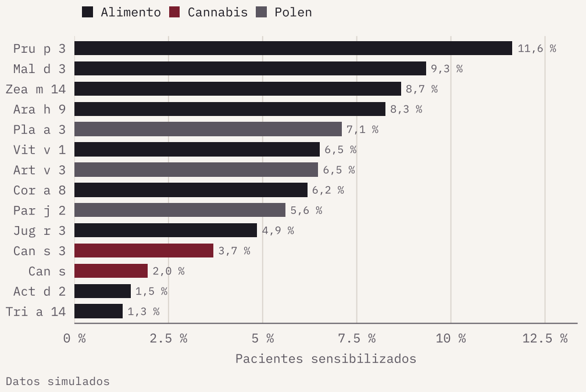
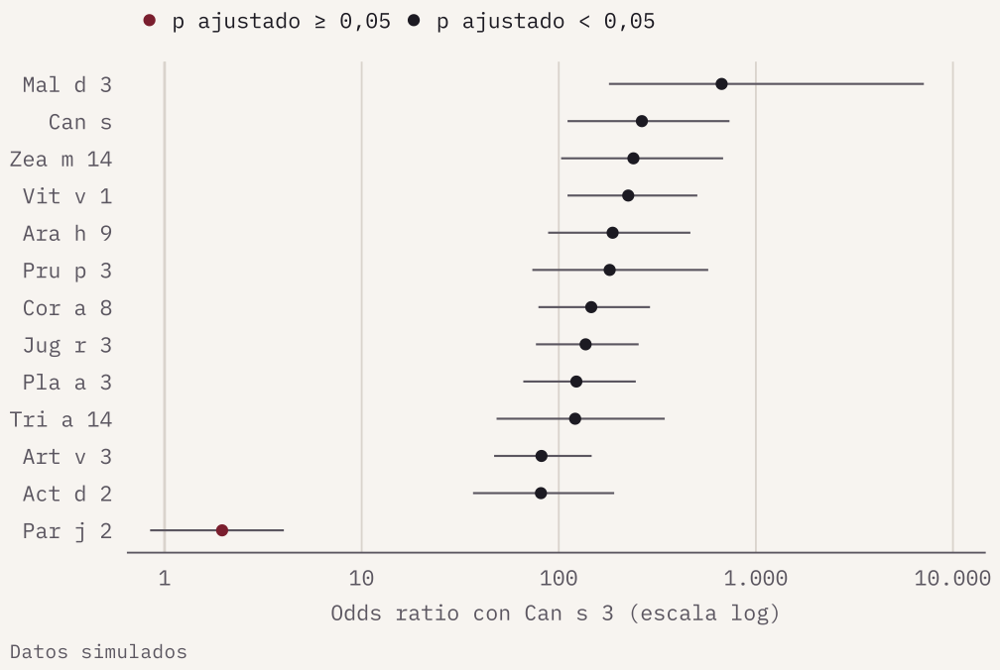
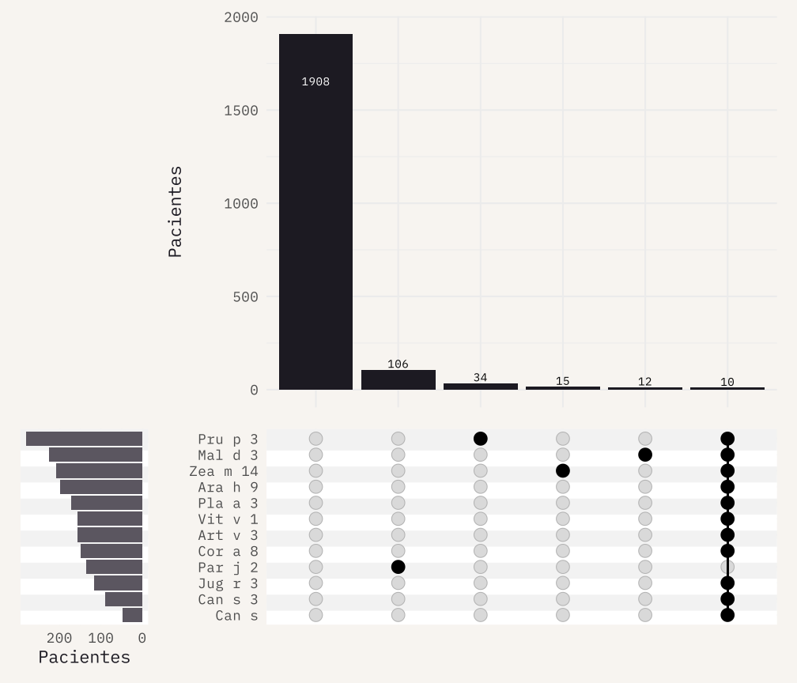
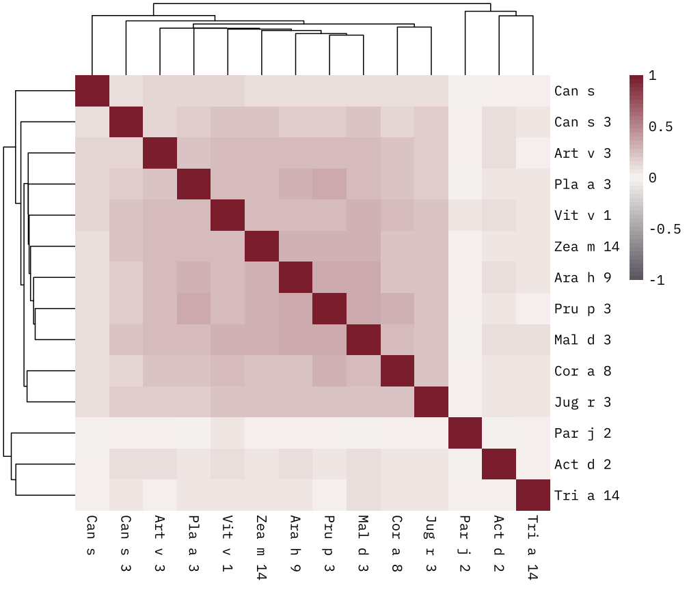
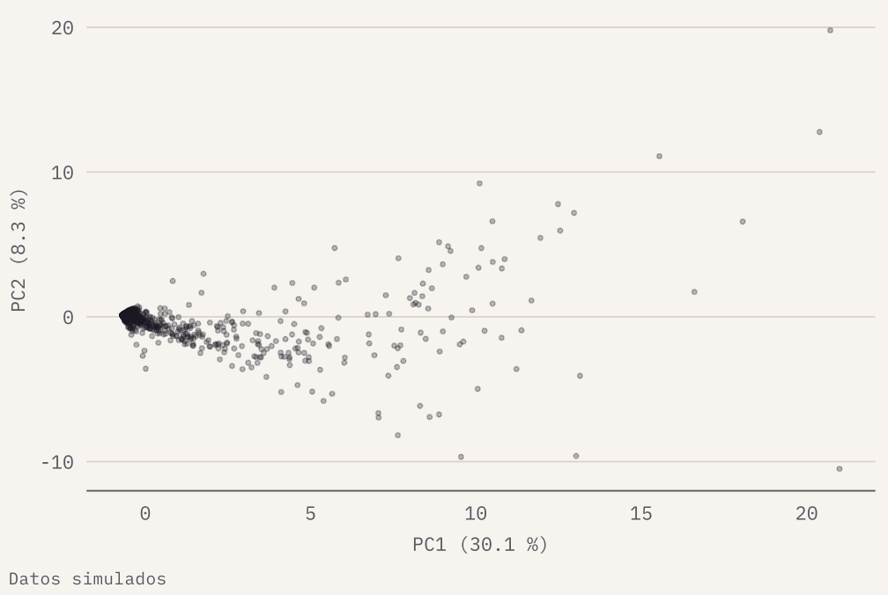
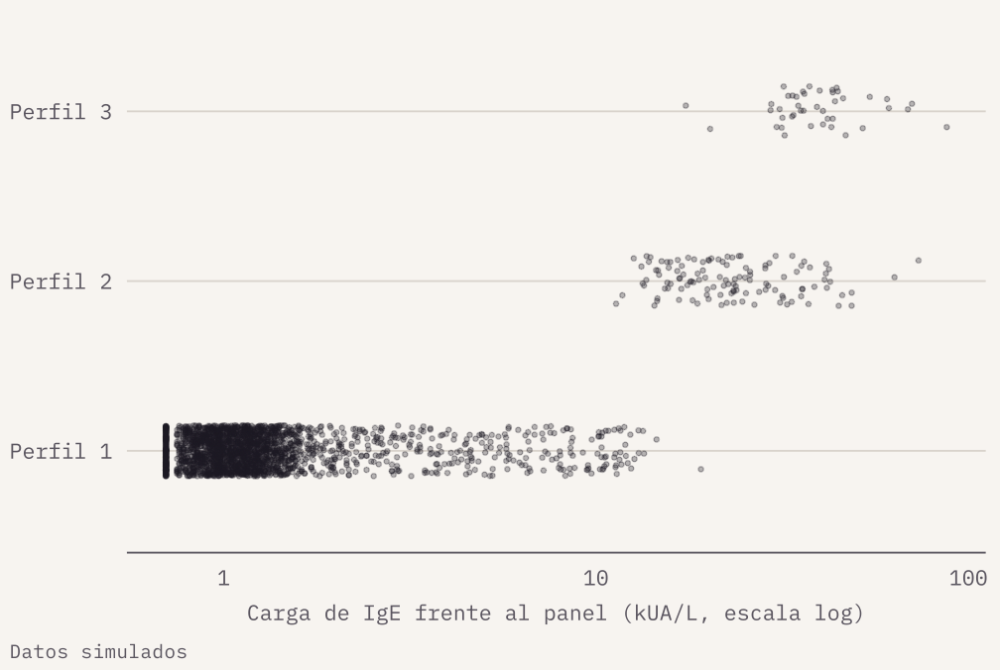

Can s 3 y proteínas de transferencia de lípidos (nsLTP):
co-sensibilización
================

- [0. Cabecera](#0-cabecera)
- [1. Configuración](#1-configuración)
  - [Tamaño muestral](#tamaño-muestral)
- [2. Datos](#2-datos)
- [3. Descriptivos](#3-descriptivos)
- [4. Análisis principal](#4-análisis-principal)
  - [4.1. Prevalencia de sensibilización a cada
    componente](#41-prevalencia-de-sensibilización-a-cada-componente)
  - [4.2. Co-sensibilización entre Can s 3 y el resto del
    panel](#42-co-sensibilización-entre-can-s-3-y-el-resto-del-panel)
- [5. Análisis secundarios](#5-análisis-secundarios)
  - [5.1. Combinaciones más frecuentes
    (UpSet)](#51-combinaciones-más-frecuentes-upset)
  - [5.2. Correlación entre niveles de IgE
    específica](#52-correlación-entre-niveles-de-ige-específica)
  - [5.3. Análisis de componentes principales
    (PCA)](#53-análisis-de-componentes-principales-pca)
  - [5.4. Perfiles de pacientes
    (k-means)](#54-perfiles-de-pacientes-k-means)
  - [5.5. IgE total y número de componentes
    positivos](#55-ige-total-y-número-de-componentes-positivos)
- [6. Figuras](#6-figuras)
- [7. Información de la sesión](#7-información-de-la-sesión)

## 0. Cabecera

**Artículo:** Cross-sensitization between *Cannabis sativa* and lipid
transfer proteins: evidence from a large molecular cohort. *Allergy
Asthma Proc* 2026; 47. <https://doi.org/10.2500/aap.2026.47.260045>

**Objetivo.** Estimar la prevalencia de sensibilización a Can s 3, la
LTP del cannabis, y describir con qué otras nsLTP de alimentos y pólenes
aparece.

**Diseño.** Estudio observacional retrospectivo. Pacientes remitidos
para estudio alergológico con la plataforma multiplex ALEX2.

**Variables principales**

| Variable                                   | Descripción                                                       |
|--------------------------------------------|-------------------------------------------------------------------|
| `id`                                       | Identificador ficticio del paciente                               |
| `total_ige`                                | IgE total (kU/L); “\< 20” se guarda como 10 y “\> 2500” como 2500 |
| `can_s_3`, `can_s`                         | IgE específica (kUA/L) a Can s 3 y al extracto de *C. sativa*     |
| `pru_p_3`, `mal_d_3`, `vit_v_1`, `act_d_2` | nsLTP de frutas: melocotón, manzana, uva, kiwi                    |
| `ara_h_9`, `cor_a_8`, `jug_r_3`            | nsLTP de frutos secos y legumbres: cacahuete, avellana, nuez      |
| `tri_a_14`, `zea_m_14`                     | nsLTP de cereales: trigo, maíz                                    |
| `art_v_3`, `par_j_2`, `pla_a_3`            | nsLTP de pólenes: artemisa, parietaria, plátano de sombra         |

En la IgE específica, “\< 0,10” se guarda como 0,05 (la mitad del límite
de detección). Esa imputación solo afecta a los análisis cuantitativos:
para clasificar como sensibilizado o no, cualquier valor \< 0,35 es
negativo.

> **Datos simulados.** Este repositorio no contiene datos de pacientes.
> El archivo `data/cannabis_ltp_simulado.csv` lo genera
> `R/simular_datos.R` con la misma estructura que los datos reales y
> prevalencias y co-sensibilizaciones parecidas a las publicadas. Las
> cifras se parecen, pero no son las del artículo.

## 1. Configuración

``` r
library(dplyr)
library(tidyr)
library(ggplot2)
library(pwr)           # precisión y diferencia mínima detectable
library(ComplexUpset)  # gráfico UpSet de co-sensibilización
library(pheatmap)      # mapas de calor

source("R/theme_pmenor.R")
usar_pmenor(base_size = 12, fondo = "papel")

SENS_CUTOFF <- 0.35   # sensibilización: IgE específica >= 0,35 kUA/L
K_CLUSTERS  <- 3      # número de perfiles en el k-means

# Panel: componente, etiqueta y origen
PANEL <- tribble(
  ~var,       ~label,     ~source,
  "can_s_3",  "Can s 3",  "Cannabis",
  "can_s",    "Can s",    "Cannabis",
  "pru_p_3",  "Pru p 3",  "Alimento",
  "mal_d_3",  "Mal d 3",  "Alimento",
  "vit_v_1",  "Vit v 1",  "Alimento",
  "act_d_2",  "Act d 2",  "Alimento",
  "ara_h_9",  "Ara h 9",  "Alimento",
  "cor_a_8",  "Cor a 8",  "Alimento",
  "jug_r_3",  "Jug r 3",  "Alimento",
  "tri_a_14", "Tri a 14", "Alimento",
  "zea_m_14", "Zea m 14", "Alimento",
  "art_v_3",  "Art v 3",  "Polen",
  "par_j_2",  "Par j 2",  "Polen",
  "pla_a_3",  "Pla a 3",  "Polen"
)
COMPONENTS <- PANEL$var
LABELS     <- setNames(PANEL$label, PANEL$var)
OTHERS     <- setdiff(COMPONENTS, "can_s_3")   # los 13 que se comparan con Can s 3
```

### Tamaño muestral

Al ser retrospectivo, no se calculó el tamaño muestral a priori. Lo que
sí se puede comprobar es qué permitía la muestra disponible, sin usar
los resultados obtenidos.

**Precisión.** ¿Con qué margen se estima una prevalencia baja, como la
de Can s 3 (en torno al 4 %), con 2.409 pacientes?

``` r
n_total <- 2409
p_cans3 <- 0.037
margin  <- qnorm(0.975) * sqrt(p_cans3 * (1 - p_cans3) / n_total)
round(100 * margin, 2)   # margen de error del IC 95 %, en puntos porcentuales
```

    #> [1] 0.75

**Diferencia mínima detectable.** Con unos 90 pacientes Can s 3
positivos y unos 2.320 negativos, ¿qué diferencia en la prevalencia de
otra nsLTP se podía detectar con una potencia del 80 %? ¿Y qué
correlación con toda la cohorte?

``` r
n_pos <- round(n_total * p_cans3)
n_neg <- n_total - n_pos

# Partiendo de una prevalencia del 7 % en los Can s 3 negativos
h <- pwr.2p2n.test(n1 = n_pos, n2 = n_neg, power = 0.80, sig.level = 0.05)$h
round(100 * sin(asin(sqrt(0.07)) + h / 2)^2, 1)   # prevalencia detectable en Can s 3+
```

    #> [1] 16.6

``` r
# Correlación mínima detectable
round(pwr.r.test(n = n_total, power = 0.80, sig.level = 0.05)$r, 3)
```

    #> [1] 0.057

Una nsLTP con un 7 % de positivos en la población general tendría que
llegar a algo más del 17 % en los Can s 3 positivos para detectarse con
seguridad. Las asociaciones que busca el estudio son mucho mayores.

## 2. Datos

``` r
if (!file.exists("data/cannabis_ltp_simulado.csv")) source("R/simular_datos.R")
ltp <- read.csv("data/cannabis_ltp_simulado.csv")

ltp <- ltp |>
  mutate(
    n_sens    = rowSums(across(all_of(COMPONENTS), \(x) x >= SENS_CUTOFF), na.rm = TRUE),
    any_sens  = n_sens >= 1,
    # Carga del panel: suma de IgE específica a todos los componentes
    panel_load = rowSums(across(all_of(COMPONENTS)), na.rm = TRUE)
  )

# Versión binaria (sensibilizado sí/no) para los análisis cualitativos
binary <- ltp |>
  mutate(across(all_of(COMPONENTS), \(x) !is.na(x) & x >= SENS_CUTOFF))

glimpse(ltp)
```

    #> Rows: 2,409
    #> Columns: 19
    #> $ id         <chr> "P0001", "P0002", "P0003", "P0004", "P0005", "P0006", "P000…
    #> $ total_ige  <dbl> 10.0, 162.5, 10.0, 439.5, 166.2, 302.4, 48.9, 10.0, 128.8, …
    #> $ pru_p_3    <dbl> 0.05, 0.05, 0.05, 0.05, 0.05, 0.05, 0.05, 0.05, 0.05, 0.05,…
    #> $ mal_d_3    <dbl> 0.05, 0.25, 0.05, 0.05, 0.05, 0.05, 0.05, 0.05, 0.05, 0.05,…
    #> $ zea_m_14   <dbl> 0.25, 0.05, 0.05, 0.05, 0.05, 0.12, 0.05, 0.05, 0.05, 0.05,…
    #> $ ara_h_9    <dbl> 0.05, 0.05, 0.05, 0.05, 0.26, 0.05, 0.05, 0.05, 0.05, 0.05,…
    #> $ vit_v_1    <dbl> 0.05, 0.05, 0.05, 0.05, 0.05, 0.05, 0.05, 0.05, 0.32, 0.05,…
    #> $ pla_a_3    <dbl> 0.05, 0.05, 0.05, 0.05, 0.05, 0.05, 0.05, 0.05, 0.05, 0.05,…
    #> $ art_v_3    <dbl> 0.05, 0.05, 0.05, 0.05, 0.05, 0.05, 0.05, 0.05, 0.23, 0.05,…
    #> $ cor_a_8    <dbl> 0.05, 0.05, 0.05, 0.05, 0.05, 0.05, 0.05, 0.05, 0.21, 0.05,…
    #> $ par_j_2    <dbl> 0.05, 0.20, 0.29, 0.05, 0.12, 0.05, 0.05, 0.05, 0.05, 0.05,…
    #> $ jug_r_3    <dbl> 0.05, 0.05, 0.05, 0.05, 0.05, 0.05, 0.05, 0.05, 0.05, 0.05,…
    #> $ can_s_3    <dbl> 0.05, 0.05, 0.19, 0.28, 0.05, 0.05, 0.05, 0.05, 0.05, 0.05,…
    #> $ act_d_2    <dbl> 0.05, 0.05, 0.14, 0.05, 0.05, 0.05, 0.05, 0.05, 0.05, 0.05,…
    #> $ tri_a_14   <dbl> 0.05, 0.05, 0.23, 0.14, 0.05, 0.05, 0.05, 0.05, 0.15, 0.05,…
    #> $ can_s      <dbl> 0.05, 0.05, 0.05, 0.05, 0.05, 0.05, 0.05, 0.05, 0.05, 0.05,…
    #> $ n_sens     <dbl> 0, 0, 0, 0, 0, 0, 0, 0, 0, 0, 0, 0, 0, 0, 0, 0, 0, 0, 0, 0,…
    #> $ any_sens   <lgl> FALSE, FALSE, FALSE, FALSE, FALSE, FALSE, FALSE, FALSE, FAL…
    #> $ panel_load <dbl> 0.90, 1.05, 1.35, 1.02, 0.98, 0.77, 0.70, 0.70, 1.41, 0.70,…

## 3. Descriptivos

``` r
ltp |>
  summarise(
    n                  = n(),
    any_sens_pct       = round(100 * mean(any_sens), 1),
    total_ige_median   = median(total_ige),
    total_ige_q1       = quantile(total_ige, 0.25),
    total_ige_q3       = quantile(total_ige, 0.75),
    total_ige_below_20 = sum(total_ige == 10),
    total_ige_above_2500 = sum(total_ige == 2500)
  )
```

    #>      n any_sens_pct total_ige_median total_ige_q1 total_ige_q3
    #> 1 2409         20.8             86.6         37.3        209.3
    #>   total_ige_below_20 total_ige_above_2500
    #> 1                274                   26

``` r
# Número de componentes positivos por paciente
table(ltp$n_sens)
```

    #> 
    #>    0    1    2    3    4    5    6    7    8    9   10   11   12   13   14 
    #> 1908  195   75   32   20   34   24   23   20   16   17   19   17    8    1

## 4. Análisis principal

### 4.1. Prevalencia de sensibilización a cada componente

``` r
prev <- binary |>
  summarise(across(all_of(COMPONENTS), mean)) |>
  pivot_longer(everything(), names_to = "var", values_to = "prevalence") |>
  mutate(prevalence = 100 * prevalence) |>
  left_join(PANEL, by = "var") |>
  arrange(desc(prevalence))

prev |> select(label, source, prevalence) |> mutate(prevalence = round(prevalence, 1))
```

    #> # A tibble: 14 × 3
    #>    label    source   prevalence
    #>    <chr>    <chr>         <dbl>
    #>  1 Pru p 3  Alimento       11.6
    #>  2 Mal d 3  Alimento        9.3
    #>  3 Zea m 14 Alimento        8.7
    #>  4 Ara h 9  Alimento        8.3
    #>  5 Pla a 3  Polen           7.1
    #>  6 Vit v 1  Alimento        6.5
    #>  7 Art v 3  Polen           6.5
    #>  8 Cor a 8  Alimento        6.2
    #>  9 Par j 2  Polen           5.6
    #> 10 Jug r 3  Alimento        4.9
    #> 11 Can s 3  Cannabis        3.7
    #> 12 Can s    Cannabis        2  
    #> 13 Act d 2  Alimento        1.5
    #> 14 Tri a 14 Alimento        1.3

``` r
ggplot(prev, aes(reorder(label, prevalence), prevalence, fill = source)) +
  geom_col(width = 0.7) +
  geom_text(aes(label = paste0(numeros_pmenor(accuracy = 0.1)(prevalence), " %")),
            hjust = -0.15, size = 3.2) +
  coord_flip() +
  scale_fill_manual(values = c(Cannabis = pmenor_col[["burdeos"]],
                               Alimento = pmenor_col[["tinta"]],
                               Polen    = pmenor_col[["gris"]])) +
  scale_y_continuous(labels = \(x) paste0(x, " %"), expand = expansion(c(0, 0.15))) +
  labs(x = NULL, y = "Pacientes sensibilizados", caption = "Datos simulados") +
  theme(panel.grid.major.y = element_blank(),
        panel.grid.major.x = element_line(colour = pmenor_col[["linea"]]))
```

<figure>

<figcaption aria-hidden="true">Prevalencia de sensibilización a cada
componente del panel.</figcaption>
</figure>

### 4.2. Co-sensibilización entre Can s 3 y el resto del panel

Una tabla 2×2 por componente (Can s 3 sí/no frente al otro componente
sí/no), con el test exacto de Fisher: con un 4 % de Can s 3 positivos
hay casillas con muy pocos casos y el χ² no es fiable. La odds ratio y
su IC 95 % salen del mismo test. Son 13 comparaciones, así que se añade
el p ajustado por Bonferroni (el que se usa para decidir) y por
Benjamini-Hochberg.

``` r
cross <- lapply(OTHERS, function(a) {
  tab <- table(can_s_3 = factor(binary$can_s_3, levels = c(FALSE, TRUE)),
               other   = factor(binary[[a]],     levels = c(FALSE, TRUE)))
  f <- fisher.test(tab)
  data.frame(
    var        = a,
    prevalence = 100 * mean(binary[[a]]),
    co_sens    = 100 * mean(binary$can_s_3 & binary[[a]]),      # % del total con ambos
    in_cans3_pos = 100 * tab["TRUE", "TRUE"] / sum(tab["TRUE", ]),  # % del otro entre Can s 3+
    or = unname(f$estimate), or_low = f$conf.int[1], or_high = f$conf.int[2],
    p  = f$p.value
  )
}) |>
  bind_rows() |>
  mutate(p_bonferroni = p.adjust(p, method = "bonferroni"),
         p_bh         = p.adjust(p, method = "BH"),
         label        = LABELS[var]) |>
  arrange(p)

cross |>
  transmute(label, prevalence = round(prevalence, 1), co_sens = round(co_sens, 2),
            in_cans3_pos = round(in_cans3_pos, 1),
            or = round(or, 1), or_low = round(or_low, 1), or_high = round(or_high, 1),
            p = signif(p, 2), p_bonferroni = signif(p_bonferroni, 2))
```

    #>       label prevalence co_sens in_cans3_pos    or or_low or_high       p
    #> 1   Mal d 3        9.3    3.61         97.8 670.6  179.7  7118.8 1.8e-94
    #> 2   Vit v 1        6.5    3.28         88.8 225.1  110.7   504.6 9.4e-92
    #> 3  Zea m 14        8.7    3.45         93.3 239.2  102.8   682.2 7.5e-88
    #> 4   Ara h 9        8.3    3.36         91.0 187.6   88.3   465.4 1.8e-85
    #> 5   Cor a 8        6.2    3.07         83.1 146.2   78.8   290.4 6.2e-83
    #> 6   Pla a 3        7.1    3.11         84.3 122.8   66.1   245.9 3.9e-79
    #> 7   Jug r 3        4.9    2.78         75.3 136.8   76.6   254.2 2.2e-78
    #> 8   Pru p 3       11.6    3.49         94.4 181.2   73.4   573.2 3.2e-77
    #> 9   Art v 3        6.5    2.82         76.4  81.7   47.0   146.8 6.7e-69
    #> 10    Can s        2.0    1.66         44.9 264.0  110.8   734.8 1.1e-54
    #> 11 Tri a 14        1.3    1.00         27.0 121.1   48.3   344.8 3.4e-30
    #> 12  Act d 2        1.5    1.04         28.1  81.2   36.7   191.1 1.9e-29
    #> 13  Par j 2        5.6    0.37         10.1   2.0    0.8     4.0 9.3e-02
    #>    p_bonferroni
    #> 1       2.4e-93
    #> 2       1.2e-90
    #> 3       9.8e-87
    #> 4       2.4e-84
    #> 5       8.1e-82
    #> 6       5.1e-78
    #> 7       2.8e-77
    #> 8       4.2e-76
    #> 9       8.7e-68
    #> 10      1.4e-53
    #> 11      4.4e-29
    #> 12      2.5e-28
    #> 13      1.0e+00

¿Cuántos Can s 3 positivos lo son de forma aislada, sin ningún otro
componente del panel?

``` r
binary |>
  filter(can_s_3) |>
  summarise(can_s_3_pos = n(), isolated = sum(ltp$n_sens[binary$can_s_3] == 1))
```

    #>   can_s_3_pos isolated
    #> 1          89        0

``` r
ggplot(cross, aes(or, reorder(label, or))) +
  geom_vline(xintercept = 1, colour = pmenor_col[["linea"]]) +
  geom_errorbarh(aes(xmin = or_low, xmax = or_high), height = 0,
                 colour = pmenor_col[["gris"]]) +
  geom_point(aes(colour = p_bonferroni < 0.05), size = 2.2) +
  scale_colour_manual(values = c(`TRUE` = pmenor_col[["tinta"]], `FALSE` = pmenor_col[["burdeos"]]),
                      labels = c(`TRUE` = "p ajustado < 0,05", `FALSE` = "p ajustado ≥ 0,05")) +
  scale_x_log10(labels = numeros_pmenor(), expand = expansion(mult = c(0.03, 0.08))) +
  labs(x = "Odds ratio con Can s 3 (escala log)", y = NULL, caption = "Datos simulados") +
  theme(panel.grid.major.y = element_blank(),
        panel.grid.major.x = element_line(colour = pmenor_col[["linea"]]))
```

<figure>

<figcaption aria-hidden="true">Asociación de cada componente con Can s 3
(OR e IC 95 %, escala log).</figcaption>
</figure>

Las OR son muy altas porque Can s 3 es poco frecuente y casi siempre
aparece dentro de una polisensibilización a nsLTP. Los intervalos son
anchos por el mismo motivo: con unos 90 positivos, cada caso pesa mucho.

## 5. Análisis secundarios

### 5.1. Combinaciones más frecuentes (UpSet)

``` r
binary_labels <- binary |>
  select(all_of(COMPONENTS)) |>
  rename_with(\(x) LABELS[x])

upset(binary_labels, intersect = unname(LABELS), name = NULL, min_size = 10,
      base_annotations = list("Pacientes" = intersection_size(
        fill = pmenor_col[["tinta"]], text = list(size = 2.5))),
      set_sizes = upset_set_size(geom = geom_bar(fill = pmenor_col[["gris"]])) +
        ylab("Pacientes"),
      width_ratio = 0.2,
      themes = upset_default_themes(text = element_text(family = "IBM Plex Mono",
                                                        colour = pmenor_col[["tinta"]])))
```

<figure>

<figcaption aria-hidden="true">Combinaciones de componentes positivos
más frecuentes.</figcaption>
</figure>

### 5.2. Correlación entre niveles de IgE específica

Spearman, porque la IgE específica es muy asimétrica y está llena de
valores en el límite de detección.

``` r
corr <- ltp |>
  select(all_of(COMPONENTS)) |>
  rename_with(\(x) LABELS[x]) |>
  cor(method = "spearman", use = "pairwise.complete.obs")

pheatmap(corr, border_color = NA, fontfamily = "IBM Plex Mono",
         color = colorRampPalette(c(pmenor_col[["gris"]], pmenor_col[["papel"]],
                                    pmenor_col[["burdeos"]]))(50),
         breaks = seq(-1, 1, length.out = 51))
```

<figure>

<figcaption aria-hidden="true">Correlación de Spearman entre la IgE
específica a cada componente.</figcaption>
</figure>

### 5.3. Análisis de componentes principales (PCA)

Sobre la IgE específica estandarizada.

``` r
panel_matrix <- ltp |>
  select(all_of(COMPONENTS)) |>
  mutate(across(everything(), \(x) coalesce(x, 0)))

pca <- prcomp(panel_matrix, scale. = TRUE)
summary(pca)$importance[, 1:3]
```

    #>                             PC1     PC2      PC3
    #> Standard deviation     2.053988 1.08047 1.005231
    #> Proportion of Variance 0.301350 0.08339 0.072180
    #> Cumulative Proportion  0.301350 0.38473 0.456910

``` r
round(pca$rotation[, 1:2], 2)
```

    #>           PC1   PC2
    #> can_s_3  0.32  0.33
    #> can_s    0.26  0.48
    #> pru_p_3  0.29 -0.31
    #> mal_d_3  0.29 -0.36
    #> vit_v_1  0.26  0.04
    #> act_d_2  0.26  0.41
    #> ara_h_9  0.29 -0.17
    #> cor_a_8  0.32 -0.08
    #> jug_r_3  0.33  0.10
    #> tri_a_14 0.20  0.24
    #> zea_m_14 0.24 -0.09
    #> art_v_3  0.25 -0.14
    #> par_j_2  0.03 -0.17
    #> pla_a_3  0.28 -0.33

``` r
var_pc <- round(100 * summary(pca)$importance[2, 1:2], 1)
ggplot(as.data.frame(pca$x), aes(PC1, PC2)) +
  geom_point(alpha = 0.3, size = 1) +
  labs(x = paste0("PC1 (", var_pc[1], " %)"), y = paste0("PC2 (", var_pc[2], " %)"),
       caption = "Datos simulados")
```

<figure>

<figcaption aria-hidden="true">PCA de los perfiles de sensibilización a
nsLTP.</figcaption>
</figure>

### 5.4. Perfiles de pacientes (k-means)

k-means con 3 grupos sobre la misma matriz estandarizada, para separar a
los pacientes según su carga de IgE frente a nsLTP.

``` r
set.seed(123)   # k-means parte de centros aleatorios: semilla fija para reproducirlo
km <- kmeans(scale(panel_matrix), centers = K_CLUSTERS)
ltp$cluster <- factor(paste("Perfil", km$cluster))

ltp |>
  group_by(cluster) |>
  summarise(n = n(), panel_load_median = round(median(panel_load), 1),
            n_sens_median = median(n_sens), total_ige_median = median(total_ige),
            can_s_3_pos_pct = round(100 * mean(can_s_3 >= SENS_CUTOFF), 1)) |>
  arrange(panel_load_median) |>
  as.data.frame()
```

    #>    cluster    n panel_load_median n_sens_median total_ige_median
    #> 1 Perfil 1 2246               1.1             0            78.55
    #> 2 Perfil 2  120              22.4             7           460.50
    #> 3 Perfil 3   43              37.8            11           663.60
    #>   can_s_3_pos_pct
    #> 1             0.5
    #> 2            35.8
    #> 3            81.4

``` r
ggplot(ltp, aes(panel_load, cluster)) +
  geom_jitter(height = 0.15, alpha = 0.3, size = 0.9) +
  scale_x_log10(labels = numeros_pmenor()) +
  labs(x = "Carga de IgE frente al panel (kUA/L, escala log)", y = NULL,
       caption = "Datos simulados")
```

<figure>

<figcaption aria-hidden="true">Carga de IgE frente al panel en cada
perfil de k-means.</figcaption>
</figure>

### 5.5. IgE total y número de componentes positivos

``` r
cor.test(ltp$total_ige, ltp$n_sens, method = "spearman", exact = FALSE)
```

    #> 
    #>  Spearman's rank correlation rho
    #> 
    #> data:  ltp$total_ige and ltp$n_sens
    #> S = 1675709113, p-value < 2.2e-16
    #> alternative hypothesis: true rho is not equal to 0
    #> sample estimates:
    #>       rho 
    #> 0.2808168

## 6. Figuras

Las figuras se guardan en `output/` al ejecutar el documento (secciones
4 y 5).

## 7. Información de la sesión

``` r
sessionInfo()
```

    #> R version 4.3.3 (2024-02-29)
    #> Platform: x86_64-pc-linux-gnu (64-bit)
    #> Running under: Ubuntu 24.04.5 LTS
    #> 
    #> Matrix products: default
    #> BLAS:   /usr/lib/x86_64-linux-gnu/blas/libblas.so.3.12.0 
    #> LAPACK: /usr/lib/x86_64-linux-gnu/lapack/liblapack.so.3.12.0
    #> 
    #> locale:
    #>  [1] LC_CTYPE=C.UTF-8       LC_NUMERIC=C           LC_TIME=C.UTF-8       
    #>  [4] LC_COLLATE=C.UTF-8     LC_MONETARY=C.UTF-8    LC_MESSAGES=C.UTF-8   
    #>  [7] LC_PAPER=C.UTF-8       LC_NAME=C              LC_ADDRESS=C          
    #> [10] LC_TELEPHONE=C         LC_MEASUREMENT=C.UTF-8 LC_IDENTIFICATION=C   
    #> 
    #> time zone: Atlantic/Canary
    #> tzcode source: system (glibc)
    #> 
    #> attached base packages:
    #> [1] stats     graphics  grDevices utils     datasets  methods   base     
    #> 
    #> other attached packages:
    #> [1] pheatmap_1.0.12    ComplexUpset_1.3.3 pwr_1.3-0          ggplot2_3.4.4     
    #> [5] tidyr_1.3.1        dplyr_1.1.4       
    #> 
    #> loaded via a namespace (and not attached):
    #>  [1] gtable_0.3.4       highr_0.10         compiler_4.3.3     tidyselect_1.2.0  
    #>  [5] systemfonts_1.0.5  scales_1.3.0       yaml_2.3.8         fastmap_1.1.1     
    #>  [9] R6_2.5.1           labeling_0.4.3     generics_0.1.3     patchwork_1.2.0   
    #> [13] knitr_1.45         tibble_3.2.1       munsell_0.5.0      pillar_1.9.0      
    #> [17] RColorBrewer_1.1-3 rlang_1.1.3        utf8_1.2.4         xfun_0.41         
    #> [21] cli_3.6.2          withr_2.5.0        magrittr_2.0.3     digest_0.6.34     
    #> [25] grid_4.3.3         lifecycle_1.0.4    vctrs_0.6.5        evaluate_0.23     
    #> [29] glue_1.7.0         farver_2.1.1       fansi_1.0.5        colorspace_2.1-0  
    #> [33] rmarkdown_2.25     purrr_1.0.2        tools_4.3.3        pkgconfig_2.0.3   
    #> [37] htmltools_0.5.7
